# Baho architecture overview

Source of the diagram: [`designs/architecture.mmd`](../designs/architecture.mmd). Class and sequence diagrams: [`designs/uml/`](../designs/uml).

## Three tiers

1. **Client: React 18 + TypeScript progressive web app** (`frontend/`)
   - Learner screens in `src/components/screens/` (Kinyarwanda); the staff portal is a separate English mode built from `src/components/admin/`.
   - Redux Toolkit store (`src/store/appSlice.ts`) and REST client (`src/services/api.ts`).
   - Device-side logic in `src/lib/`: lesson ranking and the learner's topics and diseases (`personalization.ts`), streaks (`activity.ts`), phone checks (`phone.ts`), encrypted storage (`secureStore.ts`), offline cache and outbox (`offline.ts`).
   - Service worker (`public/sw.js`): network-first pages, cached app files (read from `index.html` at install), cached lesson recordings answered by byte range so seeking works offline.
2. **Server: Node 20 + Express REST API** (`backend/`)
   - Routes in `src/routes/index.js` under `/api/v1`; `authenticate` (HMAC-signed token) and `requireRole` protect staff routes.
   - Modules: `auth` (phone + PIN for learners, email for staff, password reset by email), `content`, `review` (specialist approval), `media` (recordings and generated audio), `learning` (programmes, diseases, quizzes), `progress`, `questions` (anyone may ask; the specialist's answer is published under the lesson), `issues`, `reminders`, `health`.
   - Domain classes: `LessonWorkflow` (lesson status rules), `PhoneNumber` and `LoginGuard` (sign-in), `MediaStore` (recordings, recognised by file signature).
   - Each service uses PostgreSQL and falls back to an in-memory store with the same contract when the database is unavailable (demo mode and tests).
3. **Database: PostgreSQL 16**: 16 tables, see [`designs/erd.svg`](../designs/erd.svg) and [`database/schema.sql`](../database/schema.sql). Recordings are files in the `baho_media` volume, not in the database.

## Key flows

- **Personalisation:** topics chosen at sign-up and the encrypted health profile stay on the phone. They decide the study programme, the order of diseases, the "Ibyo wahisemo" lesson list and the ranked "for you" lessons.
- **Lesson review:** a writer's lesson is saved as `review`. If its disease has a specialist, it waits in that specialist's queue (`GET /review/queue`); approval (`POST /review/lessons/:id`) publishes it, rejection sends it back as `rejected`. A request to publish a lesson that has not been through review is held back to `review` by `LessonWorkflow.resolve`, so no writer's lesson reaches learners unreviewed. A specialist is the clinical authority on the diseases assigned to them, so on those diseases they write and publish in one step; off them, their lesson waits for the specialist who owns the disease.
- **Password reset:** a staff member asks for a link (`POST /auth/forgot-password`); the server stores only the SHA-256 hash of a random token in `password_resets` and emails the link through SMTP (`modules/mail/mailer.js`). `POST /auth/reset-password` consumes the token once, writes the new scrypt hash and clears any sign-in lockout. The answer is the same whether or not the address has an account.
- **Learner PIN recovery:** learners have no email, so an admin lists or searches accounts (`GET /admin/learners`) and issues a new PIN (`POST /admin/learners/:id/pin`), returned once in the response and never stored in the clear. The learner then changes it from their profile (`POST /auth/change-password`), which applies PIN rules to phone accounts and password rules to staff accounts.
- **Recordings:** staff upload a person reading the lesson, or the disease page (`POST /admin/media/audio`); the server checks it is real audio, stores it under a random name and serves it at `/api/v1/media/...`.
- **Generated audio:** when nobody can record a lesson, a writer or specialist asks the server to read it (`POST /admin/media/audio/generate`). The `baho-tts` container speaks Kinyarwanda with `facebook/mms-tts-kin`, the quiz included: each question, a four-second silence, then the answer. The result is stored exactly like an upload, `content.audio_is_synthetic` is set, and the learner's player says *"Ijwi ryakozwe na mudasobwa"*. Uploading a recording clears the flag. If the container is absent the endpoint answers `503` and the portal asks for a recording instead; nothing else depends on it. A disease page is voiced the same way, from its own script: what the disease is, then the risk factors, the warning signs and the prevention, each under the heading the learner sees (`curricula.audio_url`).
- **Quiz:** answers go to `POST /quiz-attempts`; the server grades them and stores the score. Guests are graded on the device.
- **Offline:** after the first visit the app opens from the service worker; reports written offline wait in an outbox and are sent when the connection returns.

## Deployment

One Docker stack (`deploy/docker-compose.production.yml`: PostgreSQL, API, nginx web app, Kinyarwanda voice) behind Caddy at https://bahoapp.site. Every push to `main` runs the tests, builds the images and deploys them over SSH (`.github/workflows/deploy.yml`). Details: [deployment.md](deployment.md).

## Design principles

- Kinyarwanda for learners, English for staff; real photographs, and a human voice wherever one can be recorded. A generated voice is the floor under a silent lesson, never a replacement, and the learner is always told which they are hearing.
- Offline-first for weak rural connections; small pages for low-cost phones.
- Privacy by design: no health details on the server.
