# Baho architecture overview

Source of the diagram: [`designs/architecture.mmd`](../designs/architecture.mmd). Class and sequence diagrams: [`designs/uml/`](../designs/uml).

## Three tiers

1. **Client: React 18 + TypeScript progressive web app** (`frontend/`)
   - Learner screens in `src/components/screens/` (Kinyarwanda); the staff portal is a separate English mode built from `src/components/admin/`.
   - Redux Toolkit store (`src/store/appSlice.ts`) and REST client (`src/services/api.ts`).
   - Device-side logic in `src/lib/`: lesson ranking and the learner's topics and diseases (`personalization.ts`), streaks (`activity.ts`), phone checks (`phone.ts`), encrypted storage (`secureStore.ts`), offline cache and outbox (`offline.ts`).
   - Service worker (`public/sw.js`): network-first pages, cached app files (read from `index.html` at install), cached lesson recordings answered by byte range so seeking works offline.
2. **Server: Node 20 + Express REST API** (`backend/`)
   - Routes in `src/routes/index.js` under `/api/v1`; `authenticate` (HMAC-signed token) and `requireRole` protect staff routes.
   - Modules: `auth` (phone + PIN for learners, email for staff), `content`, `review` (specialist approval), `media` (recordings), `learning` (programmes, diseases, quizzes), `progress`, `questions`, `issues`, `reminders`, `health`.
   - Domain classes: `LessonWorkflow` (lesson status rules), `PhoneNumber` and `LoginGuard` (sign-in), `MediaStore` (recordings, recognised by file signature).
   - Each service uses PostgreSQL and falls back to an in-memory store with the same contract when the database is unavailable (demo mode and tests).
3. **Database: PostgreSQL 16** — 14 tables, see [`designs/erd.svg`](../designs/erd.svg) and [`database/schema.sql`](../database/schema.sql). Recordings are files in the `baho_media` volume, not in the database.

## Key flows

- **Personalisation:** topics chosen at sign-up and the encrypted health profile stay on the phone. They decide the study programme, the order of diseases, the "Ibyo wahisemo" lesson list and the ranked "for you" lessons.
- **Lesson review:** a writer's lesson is saved as `review`. If its disease has a specialist, it waits in that specialist's queue (`GET /review/queue`); approval (`POST /review/lessons/:id`) sets `approved`, and only then can an admin publish it (`PATCH /admin/content/:id/status`, otherwise `409`).
- **Recordings:** staff upload a person reading the lesson (`POST /admin/media/audio`); the server checks it is real audio, stores it under a random name and serves it at `/api/v1/media/…`. Lessons without a recording show no player.
- **Quiz:** answers go to `POST /quiz-attempts`; the server grades them and stores the score. Guests are graded on the device.
- **Offline:** after the first visit the app opens from the service worker; reports written offline wait in an outbox and are sent when the connection returns.

## Deployment

One Docker stack (`deploy/docker-compose.production.yml`: PostgreSQL, API, nginx web app) behind Caddy at https://baho.filito.rw. Every push to `main` runs the tests, builds the images and deploys them over SSH (`.github/workflows/deploy.yml`). Details: [deployment.md](deployment.md).

## Design principles

- Kinyarwanda for learners, English for staff; real photographs and real human voice only.
- Offline-first for weak rural connections; small pages for low-cost phones.
- Privacy by design: no health details on the server.
